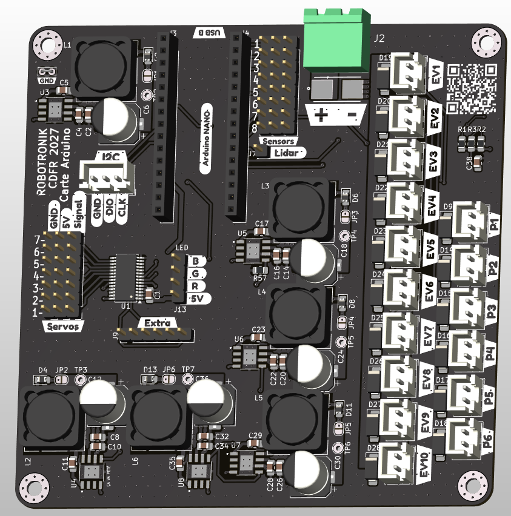
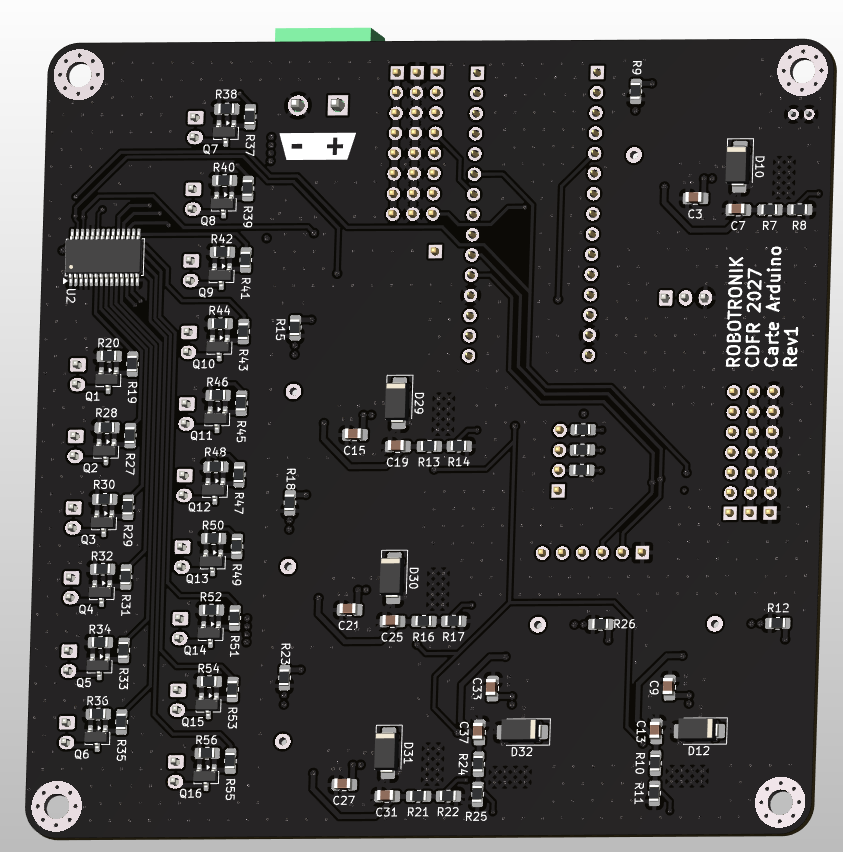
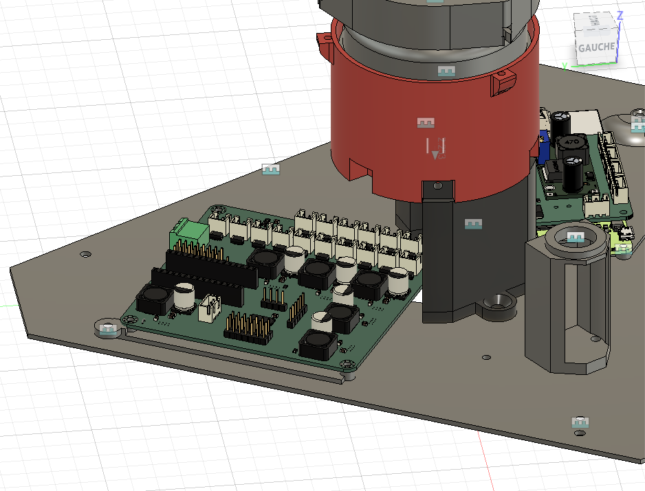
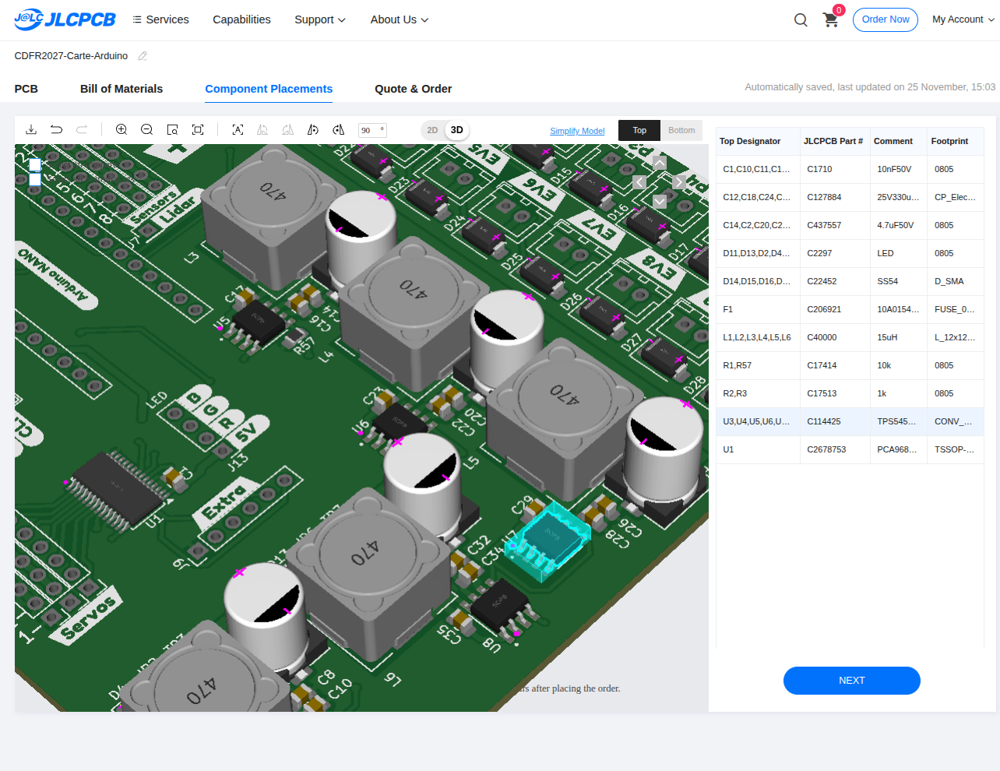

# JLCPCB et Robotronik : une carte pour piloter tous les actionneurs du robot de la CDFR 2027

Chaque année, les étudiants de l'association **Robotronik** (Grenoble INP – Phelma) repartent d'une page blanche pour concevoir le robot qui les représentera à la **Coupe de France de Robotique**. Et chaque année, la même évidence s'impose : sans électronique sur mesure, un robot autonome ne peut tout simplement pas exister.

Pour la saison 2027, l'équipe a fait appel une nouvelle fois à **JLCPCB** pour fabriquer et assembler la carte qui équipe son robot principal. Retour sur un projet qui illustre bien ce que permettent aujourd'hui la fabrication de PCB multicouches et le service PCBA.

## Une carte unique pour tous les actionneurs

Le robot de la CDFR 2027 embarque de nombreux actionneurs : pompes, électrovannes, servomoteurs et actionneurs auxiliaires. Plutôt que de multiplier les cartes et les câblages, l'équipe a conçu une carte unique, la **CDFR2027-Carte-Arduino**, qui centralise le pilotage de l'ensemble.

Ses caractéristiques principales :

- un PCB de **100 × 100 mm**, en **4 couches**, épaisseur 1,6 mm, avec des coins arrondis pour une intégration propre dans le châssis ;
- **6 convertisseurs à découpage TPS5450** qui génèrent les rails 5 V à partir de la batterie du robot ;
- **10 sorties électrovannes** et **6 sorties pompes**, dimensionnées pour les courants d'appel de ces actionneurs ;
- **2 expandeurs PCA9685**, soit **32 sorties PWM** pour les servomoteurs et les sorties auxiliaires ;
- un bus **I²C** vers la **Raspberry Pi 5** qui pilote la carte, avec une entrée d'activation matérielle (*Output Enable*) ;
- un fusible 10 A en entrée, des LEDs d'état, ainsi que des connecteurs dédiés aux capteurs et au LiDAR.

Le résultat est une carte dense : **154 composants CMS répartis sur les deux faces**, du TSSOP-28 au pas de 0,65 mm, du SOT-23, du SMA et de nombreux composants 0805.

## La BOM automatique : gagner du temps et éviter les erreurs

Première étape de toute commande : transformer la nomenclature issue de KiCad en une BOM exploitable. C'est là que l'**outil BOM automatique de JLCPCB** change la donne.

L'équipe exporte sa BOM et le fichier de placement depuis KiCad, puis les importe sur le site de JLCPCB. L'outil associe automatiquement chaque ligne à une référence de composant du catalogue, avec le stock, le prix et les substitutions disponibles. Pour une carte de cette densité — une vingtaine de lignes, des séries de résistances et de condensateurs, mais aussi des références précises comme les PCA9685PW et les TPS5450 — cela représente un gain de temps considérable et, surtout, une réduction drastique des risques d'erreur de saisie.

## Le PCBA Standard en double face : assembler ce que l'on ne saurait pas souder

Les membres de Robotronik savent concevoir un schéma, router un PCB quatre couches, le mettre sous tension et le déboguer. En revanche, l'association n'a **ni les compétences ni l'équipement** nécessaires pour assembler complètement à la main 154 composants CMS répartis sur les deux faces d'une carte, dont des circuits intégrés au pas de 0,65 mm.

Le service **PCBA Standard** de JLCPCB, avec son **assemblage double face**, répond exactement à ce besoin : l'équipe reçoit des cartes déjà assemblées, qu'il ne reste plus qu'à brancher, tester et intégrer dans le robot. Sans cette prestation, la carte n'aurait tout simplement pas pu être produite dans les délais de la saison.

L'outil de placement de JLCPCB permet également de vérifier, composant par composant et face par face, la position et l'orientation de chaque référence avant de valider la commande.

Au-delà du temps gagné, cette approche apporte une réelle fiabilité : chaque exemplaire est assemblé de manière identique, ce qui facilite le diagnostic et permet de disposer de cartes de rechange prêtes à l'emploi.

## Un PCB 4 couches pensé pour la puissance et la lisibilité

Le routage de cette carte a été guidé par deux contraintes fortes : faire passer des courants importants vers les actionneurs et garder une électronique de commande propre.

Le **PCB 4 couches** de JLCPCB permet justement de séparer plans de puissance et signaux, de réduire les boucles de courant des convertisseurs à découpage et de garder un routage lisible malgré la densité de composants. Les options de fabrication standards — masque vert, finition classique, épaisseur 1,6 mm — suffisent largement à ce type de carte, pour un coût maîtrisé.

## Trois cartes, des délais courts

Pour cette saison, **trois exemplaires** de la carte ont été commandés : une carte principale, une carte de secours et un exemplaire dédié aux essais. Grâce au sponsoring de JLCPCB, la question du budget ne vient pas freiner le développement, et les **délais courts** de fabrication et d'assemblage restent compatibles avec le calendrier serré d'une saison de CDFR.

## Une collaboration qui forme aussi les étudiants

Pour une association étudiante, l'intérêt d'un partenaire comme JLCPCB dépasse largement la fabrication. Recevoir une carte assemblée selon des standards industriels, c'est pouvoir la tester le soir même, itérer rapidement et consacrer l'essentiel du temps au logiciel embarqué, aux réglages et aux essais sur la table officielle.

C'est aussi une formidable expérience pédagogique : les membres suivent l'intégralité de la chaîne, du schéma KiCad à la carte assemblée dans le robot, en passant par la préparation de la BOM et du fichier de placement.

## Conclusion

Avec la **CDFR2027-Carte-Arduino**, Robotronik dispose d'une base électronique unique, fiable et reproductible pour piloter tous les actionneurs de son robot principal. La combinaison de la **BOM automatique**, du **PCB 4 couches** et du **PCBA Standard double face** de JLCPCB a permis à l'équipe de transformer une conception ambitieuse en cartes réellement fonctionnelles, dans les délais de la compétition.

Merci à JLCPCB de soutenir la Coupe de France de Robotique et les équipes étudiantes !

**Pour en savoir plus sur Robotronik :**

- Instagram : [instagram.com/robotronik.phelma](https://www.instagram.com/robotronik.phelma/)
- Facebook : [facebook.com/robotronik.phelma](https://www.facebook.com/robotronik.phelma)
- Discord : [discord.com/invite/wfqBdtD2uf](https://discord.com/invite/wfqBdtD2uf)
- Wiki : [wiki.robotronik.fr](https://wiki.robotronik.fr/)
- LinkedIn : [linkedin.com/company/robotronik-phelma](https://www.linkedin.com/company/robotronik-phelma/)
